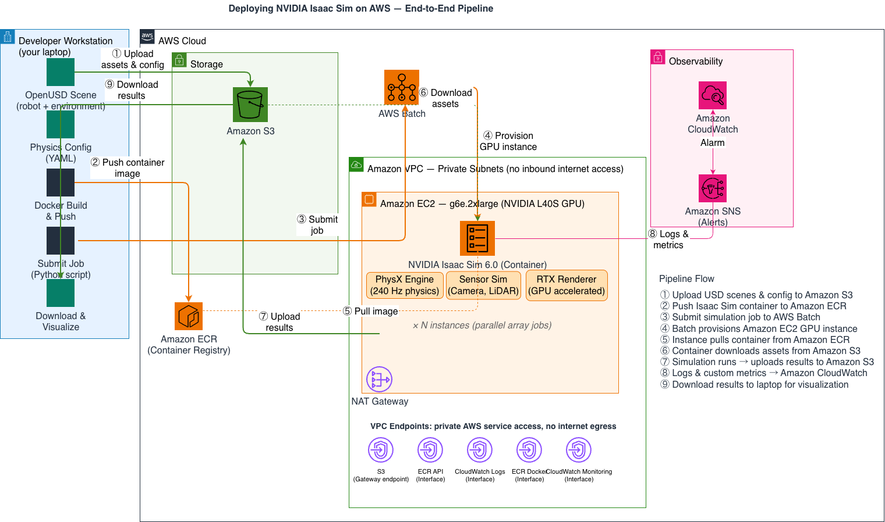

# Isaac Sim on AWS — Batch Orchestration

Run parallel NVIDIA Isaac Sim physics simulations on AWS Batch with GPU instances that scale to zero between runs.

## What this does

Deploys a containerized Isaac Sim pipeline that:
- Runs physics-accurate robotics simulation headless on NVIDIA GPUs
- Orchestrates parallel jobs with [AWS Batch](https://docs.aws.amazon.com/batch/)
- Stores configs and results in [Amazon S3](https://docs.aws.amazon.com/s3/)
- Compute scales to zero between runs
- Supports domain randomization via array jobs

## When to use Batch mode

| Mode | Best for | Guide |
|------|----------|-------|
| **GUI Mode** | Scene building, visual debugging, watching policies | [GUI Mode Guide](../../gui-mode-guide.md) |
| **Headless Mode** | Single-instance training, interactive debugging | [Headless Mode Guide](../../headless-mode-guide.md) |
| **Batch Mode** (this) | Parallel simulation at scale, synthetic data, CI/CD | You are here |

Choose Batch mode when you need hundreds of parallel runs or automated pipelines.

## Architecture



| Component | Service | Role |
|-----------|---------|------|
| Scene storage | [Amazon S3](https://docs.aws.amazon.com/s3/) | Configs, results |
| Container registry | [Amazon ECR](https://docs.aws.amazon.com/ecr/) | Isaac Sim container image |
| Job orchestration | [AWS Batch](https://docs.aws.amazon.com/batch/) | Scheduling, scaling, retry |
| GPU compute | [Amazon EC2](https://docs.aws.amazon.com/ec2/) g6e.2xlarge (L40S) | Runs Isaac Sim headless |
| Observability | [Amazon CloudWatch](https://docs.aws.amazon.com/cloudwatch/) | Logs, metrics, alerts |
| Infrastructure | [Terraform](https://developer.hashicorp.com/terraform) (AWS provider) | Reproducible deployment |

## Prerequisites

- AWS account with EC2 G6e or G5 quota (at least 8 vCPUs; an array of 4 needs 32)
- [NVIDIA NGC account](https://ngc.nvidia.com/) (free)
- Terraform >= 1.5, Python 3.12+, Docker
- AWS CLI configured
- 25 GB free disk space

## Quick start

```bash
# Clone the toolchain
git clone https://github.com/aws-samples/sample-the-physical-ai-toolchain-on-aws.git
cd sample-the-physical-ai-toolchain-on-aws/isaac-sim-on-aws/infra/batch

# Set up the local environment (venv + Python deps)
bash setup.sh
source .venv/bin/activate
export AWS_REGION=us-east-1
export AWS_DEFAULT_REGION=us-east-1

# Deploy infrastructure (Terraform root is this directory)
terraform init
terraform apply

# Resolve the created bucket name from Terraform outputs
export BUCKET=$(terraform output -raw bucket_name)

# Build and push the container image to ECR
export NGC_API_KEY=<your-ngc-api-key>
bash scripts/push_image.sh

# Upload config and run a single job
aws s3 cp config/default.yaml s3://$BUCKET/configs/default.yaml
python scripts/submit_job.py

# Scale: run 4 parallel simulations
python scripts/generate_configs.py $BUCKET --count 4
python scripts/submit_array_job.py 4
```

## Structure

```
infra/batch/
├── versions.tf              # Terraform + AWS provider version constraints
├── variables.tf             # Region, instance types, vCPUs, image tag, alert email
├── main.tf                  # VPC/NAT, S3, ECR, IAM, Batch, CloudWatch dashboard/alarm
├── outputs.tf               # bucket_name, repo_uri, job_queue, dashboard_url
├── container/
│   ├── Dockerfile           # Isaac Sim 6.0 + AWS CLI + simulation code
│   └── entrypoint.sh        # Download config, run sim, upload results, push metrics
├── simulation/
│   ├── run_simulation.py    # Main simulation script
│   ├── sensors.py           # Camera sensor setup
│   ├── physics_config.py    # Physics parameters
│   └── visualize_results.py # Local result visualization
├── config/
│   └── default.yaml         # Simulation parameters
├── scripts/
│   ├── submit_job.py        # Submit single job
│   ├── submit_array_job.py  # Submit parallel array job (positional size argument)
│   ├── generate_configs.py  # Generate varied configs for domain randomization
│   └── push_image.sh        # Build + push container to ECR
├── setup.sh                 # Environment setup
└── requirements.txt
```

## Cleanup

```bash
export BUCKET=$(terraform output -raw bucket_name)
aws s3 rm "s3://$BUCKET" --recursive
terraform destroy
```

## Full walkthrough

For the complete step-by-step guide with explanations, see the companion blog post: [Parallel Robotics Simulation with Isaac Sim on AWS Batch](#).

## Related guides

- [GUI Mode Guide](../../gui-mode-guide.md) — Interactive development with NICE DCV
- [Headless Mode Guide](../../headless-mode-guide.md) — Single-instance headless execution
- [Isaac Lab on AWS](../../../isaac-lab-on-aws/) — Reinforcement learning at scale
