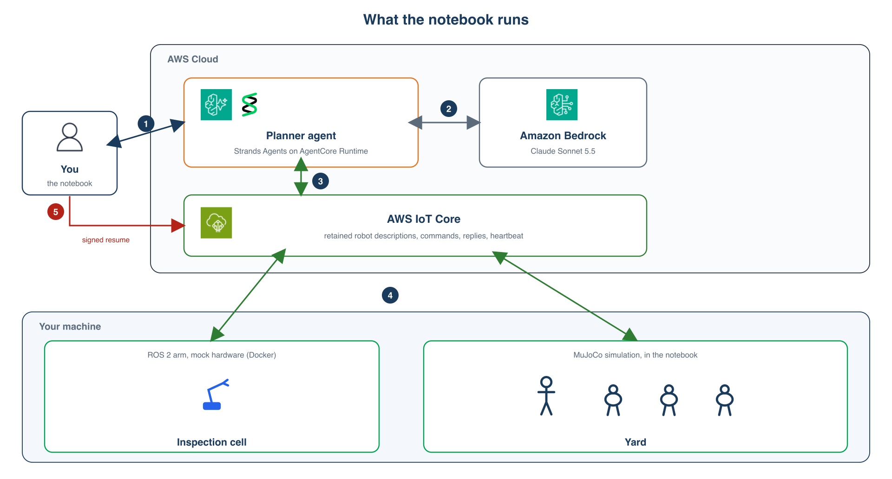

# Multi-robot task planning with Strands Agents, Amazon Bedrock AgentCore and AWS IoT Core

One goal in plain language, many kinds of robots, and every safety decision kept on the robot. A Strands Agents
planner runs on Amazon Bedrock AgentCore Runtime and splits the goal across a fleet by what each robot can do and
where it stands. AWS IoT Core connects it to the robots. On each robot, a small robot host runs the robot's trained
skills locally and enforces safety rules that no command from the cloud can override, and only an operator's signed
command resumes a stopped robot.

This is the hosted-runtime and IoT Core fleet path that this component's README lists as planned. The notebook,
`multi_robot_task_planning.ipynb`, runs a ROS 2 arm on mock hardware and a simulated MuJoCo yard (a Unitree G1 and three
Pollen Robotics Microduck walkers) end to end, with its outputs saved from a full run. The same robot host drives two
real SO-101 arms through LeRobot; that code is in `so101/`.

## What is here

| Folder | What it holds |
|---|---|
| `fleet/` | The fleet layer: `iotlink.py` (request and reply over AWS IoT Core), `robot_host.py` (the robot host and its five rules), `planner.py` (the Strands Agents planner and its eight tools, with no resume tool), and the operator's scripts: `make_operator_key.py`, `approve.py`, `resume.py`, `send_goal.py`. `test_safety.py` has one test per rule. |
| `planner_runtime/` | The planner's container for AgentCore Runtime, and `deploy.py` and `teardown.py`. |
| `ros2/` | The ROS 2 inspection arm (ros2_control with mock hardware) and `launch.py`, which starts it with its robot host. |
| `yard/` | `sim_yard.py` (the simulated yard and its robots, and `run_goal`, which sends a goal and films it) and `site_runner.py`, which steps the shared world. |
| `so101/` | The SO-101 robot host (`arm_host.py`), its LeRobot body, `arms.example.json`, and a no-hardware plumbing check. See `so101/README.md`. |

## Set up

You need an AWS account with Amazon Bedrock (a Claude model), Amazon Bedrock AgentCore and AWS IoT Core, in
us-west-2 unless you set `AWS_REGION`. Keep it a US Region: the planner's model ID, `us.anthropic.claude-sonnet-5-5`,
is a US inference profile. You also need Python 3.12, Docker for the ROS 2 arm, and Finch or Docker to build the
planner's arm64 image (`CONTAINER_BUILDER=docker` to use Docker; with Finch, run `finch vm start` first). The examples sign IoT Core requests with your IAM
credentials; in production, give each robot its own X.509 certificate.

1. Install the Python packages. strands-robots is the yard simulator only, pinned to the commit the notebook ran on:

       pip install boto3 awsiotsdk cryptography "strands-agents>=1.43" bedrock-agentcore "imageio[ffmpeg]" pillow numpy jupyter pytest
       pip install "strands-robots[mujoco,onnx] @ git+https://github.com/strands-labs/robots@e4060ca8f9d9aad1244b28edee14fb808a99f447"

2. Create the operator's key, once. The private key stays with you. The planner never gets it, and `.gitignore`
   keeps it out of git. Robot hosts get only the public key.

       python fleet/make_operator_key.py

3. Deploy the planner. This builds the image, pushes it to Amazon ECR, creates the runtime `fleet_planner` and its
   role, and writes `runtime_arn.txt`. The role may send commands to robots, and is denied the resume and approval
   topics.

       python planner_runtime/deploy.py

4. Build and start the ROS 2 inspection arm:

       docker build -t fleet-ros-arm:jazzy ros2/
       python ros2/launch.py

5. Check the robot-side rules, then run the notebook from this folder:

       (cd fleet && python -m pytest -q test_safety.py)
       jupyter notebook multi_robot_task_planning.ipynb

## Send a goal yourself

    python fleet/send_goal.py "Start the morning shift. In the inspection cell, show the part to the camera. ..."
    python fleet/resume.py duck-3           # after an e-stop: only this, signed with your key, releases a robot
    python fleet/approve.py arm-1           # when an SO-101 pick asks for approval

## Add the SO-101 packing cell

See [`so101/README.md`](so101/README.md): the arm host, the example checkpoints and datasets on the Hugging Face Hub, and
the no-hardware test.

## Clean up

    python planner_runtime/teardown.py
    docker rm -f ros-arm

## Known gaps

- The audit rules (IoT rules that copy events to Amazon S3 and Amazon SNS) aren't created by `deploy.py` yet.
